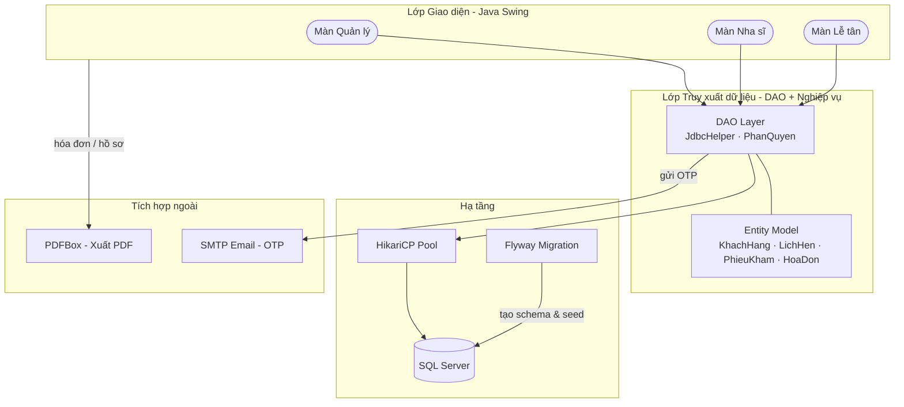
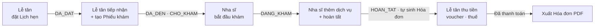

<div align="center" style="font-size: 32px;">
  <strong>B-Clinic — Quản lý Phòng khám Nha khoa</strong>
</div>

<p align="center">
  
  
  
  
</p>

---

## 1. Project Overview (Tổng quan dự án)

**B-Clinic** là phần mềm desktop quản lý toàn diện hoạt động của một phòng khám nha khoa, xây dựng bằng **Java Swing** với giao diện hiện đại (FlatLaf). Hệ thống số hóa quy trình từ **đặt lịch hẹn → tiếp nhận → khám & điều trị → lập hóa đơn → thống kê**, giúp phòng khám vận hành tập trung và chính xác.

**Đặc điểm kiến trúc:** Ứng dụng desktop nguyên khối (Monolith) chạy trực tiếp trên máy trạm, kết nối tới **Microsoft SQL Server** qua connection pool (HikariCP). Lược đồ CSDL và dữ liệu mẫu được quản lý bằng **Flyway Migration**, tự động áp dụng khi khởi động.

Hệ thống phân quyền theo **3 vai trò** — **Quản lý / Nha sĩ / Lễ tân** — mỗi vai trò có không gian làm việc riêng. Dữ liệu được tổ chức xoay quanh trục nghiệp vụ: **Khách hàng → Lịch hẹn → Phiếu khám → Hóa đơn → Hồ sơ bệnh án**.

### Công nghệ cốt lõi (Core Tech Stack):

| Phân hệ | Công nghệ sử dụng |
| :--- | :--- |
| **Runtime & UI** |    |
| **CSDL & Kết nối** |     |
| **Xuất file & Biểu đồ** |     |
| **Tích hợp & Tiện ích** |   |
| **Build** |  |

---

## 2. Architecture Overview (Tổng quan kiến trúc)

Hệ thống tổ chức theo mô hình **phân lớp (Layered)**: giao diện gọi tầng truy xuất dữ liệu, dùng chung các lớp thực thể.



> **Phân lớp:** `ui` (giao diện) → `dao` (truy xuất dữ liệu + nghiệp vụ) → `entity` (model dùng chung). Các gói `config`, `util`, `exception` hỗ trợ xuyên suốt.

---

## 3. Core Capabilities (Chức năng cốt lõi)

Hệ thống phân quyền theo 3 vai trò, mỗi vai trò có không gian làm việc riêng:

### Lễ tân (Reception)
- **Quản lý khách hàng**: thêm, sửa, tra cứu hồ sơ bệnh nhân.
- **Quản lý lịch hẹn**: đặt / đổi / hủy lịch, theo dõi trạng thái (Đã đặt → Đã đến → Hoàn tất).
- **Tiếp nhận & thanh toán**: check-in bệnh nhân, lập và thu tiền **hóa đơn** với **voucher** và **thuế GTGT** theo từng dịch vụ.
- **Tra cứu phiếu khám** và xuất **hóa đơn PDF**.

### Nha sĩ (Dentist)
- **Lịch trực & lịch cá nhân**: xem ca làm việc trong tuần, lịch hẹn theo ngày.
- **Khám & điều trị**: ghi nhận triệu chứng, **chẩn đoán / mã ICD-10**, chọn dịch vụ (hỗ trợ **lộ trình điều trị nhiều buổi**), hoàn tất phiếu khám.
- **Tra cứu hồ sơ bệnh án** (chỉ bệnh nhân của mình — kiểm soát qua phân quyền).
- **Thống kê cá nhân**: lượt khám hoàn tất, doanh thu, biểu đồ **doanh thu theo ngày**.

### Quản lý (Manager)
- **Tổng quan vận hành** phòng khám theo thời gian thực.
- **Quản lý danh mục**: nhân viên, dịch vụ & loại dịch vụ, voucher.
- **Lịch làm việc & đơn nghỉ phép** của nhân viên.
- **Báo cáo – thống kê** doanh thu, dịch vụ, lịch hẹn; **nhật ký hệ thống** và **sao lưu** CSDL.

### Chung (Common)
- **Đăng nhập phân quyền** theo vai trò; **quên mật khẩu** qua email (**OTP**).
- **Xuất PDF** hóa đơn và hồ sơ bệnh án (PDFBox).
- Quản lý trạng thái nghiệp vụ bằng **enum** (`TrangThaiLichHen`, `TrangThaiPhieuKham`, `VaiTro`…).

---

## 4. Getting Started (Cài đặt & Chạy)

### Yêu cầu môi trường
- **JDK 21+**, **Maven 3.8+**, **SQL Server** (bật xác thực SQL, cổng `1433`).

### Các bước
```bash
# 1. Clone dự án
git clone <repo-url>
cd BClinic

# 2. Tạo database rỗng trong SQL Server
#    CREATE DATABASE BClinic;   (Flyway sẽ tự tạo bảng & dữ liệu mẫu khi chạy)

# 3. Cấu hình CSDL: copy file mẫu rồi điền thông tin
cp database.properties.example src/main/resources/database.properties

# 4. (Tùy chọn) Cấu hình email gửi OTP
cp mail.properties.example mail.properties

# 5. Biên dịch & chạy
mvn clean compile
mvn exec:java -Dexec.mainClass="com.quanlynhakhoa.App"
```

> Có thể mở bằng **IntelliJ IDEA / NetBeans** và Run trực tiếp `com.quanlynhakhoa.App`.

**File `src/main/resources/database.properties`:**
```properties
db.host=localhost
db.port=1433
db.name=BClinic
db.username=sa
db.password=mật_khẩu_của_bạn
```

> ⚠️ `database.properties` và `mail.properties` đã nằm trong `.gitignore` — **không commit** vì chứa thông tin nhạy cảm.

### Tài khoản mẫu (mật khẩu chung: `Clinic@123`)
| Vai trò | Tên đăng nhập |
| :--- | :--- |
| Quản lý | `hieu.quanly` |
| Nha sĩ | `hieu.nhasi` |
| Lễ tân | `hieu.letan` |

---

## 5. Luồng nghiệp vụ chính (Core Business Flow)



---

## 6. Project Structure (Cấu trúc thư mục)

```
BClinic/
├── pom.xml
├── README.md
├── database.properties.example      # mẫu cấu hình CSDL
├── mail.properties.example          # mẫu cấu hình email
└── src/main/
    ├── java/com/quanlynhakhoa/
    │   ├── App.java                 # điểm khởi chạy
    │   ├── ui/                      # frame · panel · dialog · component
    │   ├── dao/                     # truy xuất dữ liệu + nghiệp vụ
    │   ├── entity/                  # thực thể + enums
    │   ├── config/                  # kết nối CSDL · Flyway · email
    │   ├── util/                    # tiện ích (mã hóa · định dạng · email…)
    │   └── exception/               # BusinessException · DataAccessException
    └── resources/
        └── db/migration/            # script Flyway (V1 · V2 · V3…)
```

---

## 7. Tác giả (Authors)

Nhóm sinh viên thực hiện đồ án môn **Phát triển ứng dụng (PTUD)** — HK1 2026–2027.

> Dự án phục vụ mục đích học tập.
